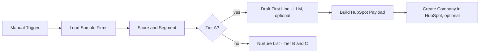

# PE Account Scoring and HubSpot Sync (n8n)

A small n8n workflow that turns a list of private equity firms into **scored, segmented accounts** with a suggested buying committee and outreach angle, then prepares tier-A accounts for HubSpot. It is a RevOps / GTM systems demo: segment, score, route, sync.

> **All firms in the sample data are fictional** (`.example` domains). Scoring weights are **assumptions** to be tuned against real closed-won data. Nothing here claims results from a real company.

## What it does



1. **Load Sample Firms**: 8 fictional firms with fund size, strategy, sector, HQ country, months since last fundraise and a debt-maturity flag. Swap for a CSV, Google Sheet, Clay table or CRM export.
2. **Score and Segment**: a 0-100 ICP score from fund size (up to 30), strategy fit (25), geography (15) and buying signals (recent fundraise 20, debt maturity 10). Tier A is 70+, Tier B is 40-69, Tier C is below 40. It also assigns a size band, a buying committee and an outreach angle by strategy.
3. **Tier A?**: routes the top accounts onward and the rest to a nurture list.
4. **Draft First Line (LLM)**: optional. Calls an LLM API for a one-sentence cold-email opener from the account's own data and signals, and is told not to make unsupported claims.
5. **Build HubSpot Payload / Create Company**: optional. Builds a HubSpot CRM v3 company payload and posts it.

## Result on the sample data

| Tier | Firms | Items |
|---|---|---|
| A | 3 | Northfield Capital Partners (100), Alder Credit Advisors (89), Summit Ridge Credit (82) |
| B | 3 | Meridian Buyout Group (69), Harbor Lane Real Assets (52), Brightwater Growth (47) |
| C | 2 | Quill Street Capital (28), Kestrel Ventures (18) |

Meridian misses Tier A by one point, which shows where threshold tuning matters.

## What was tested

Imported and executed in n8n (v2.35.7, local CLI): 8 items in, 3 to Tier A and 5 to nurture, 3 HubSpot payloads built. The two API nodes (LLM and HubSpot) are **disabled by default and were not called**, so those parts are untested against the live APIs.

## Run it

1. In n8n: **Workflows > Import from File** and choose `workflow/pe-account-scoring.n8n.json`.
2. Click **Execute workflow**. It runs with no credentials, using the sample data.

### To enable HubSpot and the LLM step

- Create a HubSpot private app token and an n8n **Header Auth** credential named `Authorization` with value `Bearer <token>`. Attach it to *Create Company in HubSpot*, then enable the node.
- In HubSpot, first create custom company properties: `icp_score`, `icp_tier`, `size_band`, `strategy`, `outreach_angle`, `buying_committee`, `signals`. Unknown properties make the API call fail.
- For the LLM node, add a Header Auth credential with name `x-api-key` and your API key, attach it, and enable the node. Check the model name in the node body against your account.
- Add the LLM output to the payload if you want the first line stored in HubSpot.

## Design choices and limits

- **Scoring is rules-based, not learned.** It is transparent and easy to explain, but the weights are guesses. In production, calibrate against won vs lost deals.
- **Enrichment is not live.** Real fund size, strategy and fundraise data would come from an enrichment source such as Clay or a data vendor. This repo shows the logic that runs after enrichment.
- **No dedupe.** Production would search HubSpot by domain first and update instead of creating duplicates.
- **No error handling or rate limits.** Add retries, a failure branch and batching before running at scale.

## Repo layout

```
workflow/pe-account-scoring.n8n.json   the importable n8n workflow
sample-data/pe_firms_sample.csv        the same fictional firms as a CSV
docs/scoring-logic.js                  the scoring code on its own, for review
```

## Author

Rakta Chouhan, Revenue Operations and GTM Systems. HubSpot, Salesforce, forecasting and funnel reporting.
